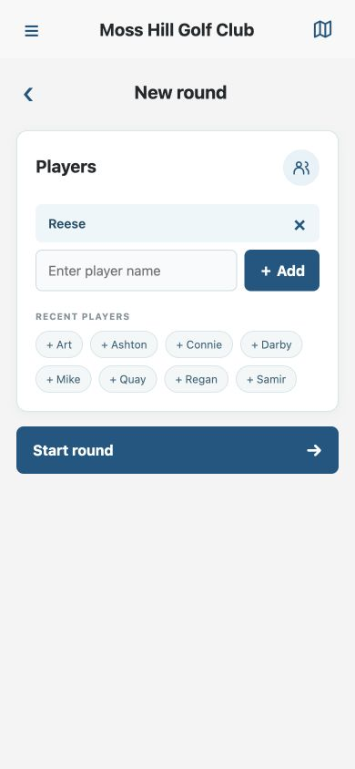
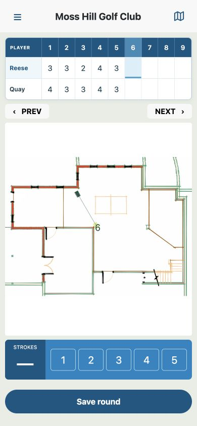
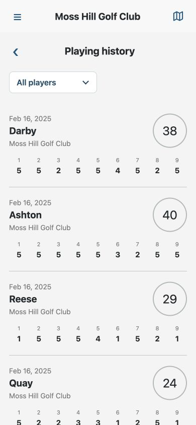
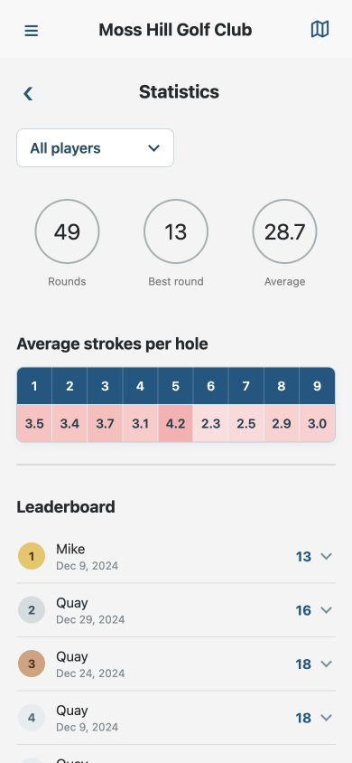

# Moss Hill Golf Club

A golf scorecard app for the Moss Hill basement course. It records
nine-hole rounds and displays playing history, statistics, and a leaderboard.

## Screenshots

| Home | New round | Scorecard | Playing history | Statistics |
| --- | --- | --- | --- | --- |
|  |  |  |  |  |

## Requirements

- Python 3
- The files in this repository

## Start the server

From the project directory, run:

```bash
python3 server.py
```

On the same computer, open:

```text
http://localhost:3001/
```

From another device on the same network, replace `localhost` with the
server computer’s IP address. For example:

```text
http://192.168.x.x:3001/
```

## Choose a version

- **V2:** Open `/` for the default mobile-friendly interface, group rounds,
  playing history, and statistics. Existing `/v2.html` links continue to work.
- **V1 (Classic):** Open `/v1`, or select **V1 (Classic)** from the V2 menu.
- **Basement Golf League:** Open `/v3/index.html` for the league homepage and
  course designer. The league homepage links to the classic scorecard.

Both scorecard versions use the same server and Moss Hill score data. Save any
in-progress round before switching interfaces. The course designer has separate
device and HTTPS requirements; see its README.

## Add V2 to an iPhone Home Screen

1. Open `/` in Safari on your iPhone.
2. Tap **Share**, then **Add to Home Screen**.
3. Open Moss Hill from the new Home Screen icon.

The server must be running and reachable from the phone. If using a
Tailscale address, both devices must be connected to Tailscale.

## Score data

Scores are stored in `scores.txt`. Each line contains a date and time,
nine hole scores, and a player name:

```text
YYYY-MM-DD HH:MM:SS,hole1,hole2,...,hole9,PlayerName
```

For example:

```text
2025-03-01 12:34:56,2,3,4,3,5,2,4,3,4,Reese
```

You can edit `scores.txt` directly with a text editor. Back it up before
making bulk changes.

## Administration

The score-editing page is not currently functional. The server’s default
admin password is set in `server.py`; change it before relying on the
admin features.

The server listens on port `3001` on all network interfaces. Use it on a
trusted network.
